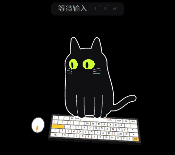
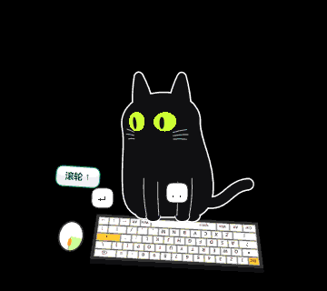

# 🐈 Tama

> 一只自用的 Windows 桌面猫：**打字与鼠标操作实时反馈** + **数据驱动的皮肤系统** + **DSH 状态联动**。
> 单文件原生实现（1.3 MB / 零运行时依赖 / 完全离线）。

<p align="center">
  
  
</p>

<p align="center">
  
  
  
  
  
</p>

---

## ✨ 能力

| | 能力 | 说明 |
|---|---|---|
| ⌨️ | **键帽气泡** | 按键时从键盘上方弹出自绘键帽：圆角 + 软投影 + 顶部高光 + 按下回弹；**组合键合并成一颗宽键帽**（`Ctrl+Shift+A`） |
| 🖱️ | **鼠标分色** | 左键蓝 / 右键红 / 中键琥珀 / 滚轮青绿 + 方向，全部在猫的鼠标道具上方弹出 |
| 🐾 | **猫的反应** | 2.5D 球面转头、瞳孔跟鼠标、打字抖耳、摸头眯眼、闲置打瞌睡 |
| 🤖 | **DSH 状态联动** | 读本地状态文件：思考 / 干活 / 完成 / 出错 → 猫的表情与气泡随之变化（见 [docs/DSH-STATE-BRIDGE.md](docs/DSH-STATE-BRIDGE.md)） |
| 🎨 | **数据驱动皮肤** | `.kurocat` 是 JSON（颜色 / 曲线分区 / 矢量花纹 / 体型），改数据就换猫；9 款内置 + 可导入 |
| 🪟 | **透明置顶** | 逐像素透明分层窗口（`UpdateLayeredWindow`）+ 智能鼠标穿透 |
| ⚡ | **轻量离线** | 1.3 MB 单文件、常驻 ≈30 MB、零依赖；**无任何出站请求** |

## 🎨 皮肤（9 款）

| 文件 | 名称 | 特点 |
|---|---|---|
| `black.kurocat` | 经典小黑猫 | 原版黑猫，荧光黄绿瞳 |
| `shorthair.kurocat` | 美短 | 银虎斑加白 + 平顶白额纹 |
| `orangeWhite.kurocat` | 橘白猫 | 橘头顶 + 白胸白手套 |
| `siamese.kurocat` | 挖煤暹罗猫 | 暖燕麦奶白 + 焦糖面罩 + 宝石蓝瞳 |
| `ragdoll.kurocat` | 暖奶茶布偶猫 | 奶油底 + 深色重点色 + 蓝眼 |
| `calico.kurocat` | 三花猫 | 白底 + 橘 / 黑斑块分区 |
| `cow.kurocat` | 奶牛猫 | 黑白燕尾服 + 白手套 + 门脸白条 |
| `robin.kurocat` | 知更夜蓝猫 | 夜蓝底 + 暖橙胸羽 + 琥珀瞳 |
| `stage.kurocat` | 舞台夜色猫 | 深紫夜底 + 霓虹蓝粉尾纹 |

> 换肤：右键小猫 →「猫咪皮肤」；或把 `.kurocat` 拖进「换装间」。格式规范见 [docs/skin-format.md](docs/skin-format.md)。

## 🚀 快速开始

```bat
:: 需要 MinGW g++（或 MSVC）
build.cmd     :: 产出 dist\\tama.exe + dist\\skins\\
run.cmd       :: 启动（先结束旧实例）
```

## 🤖 DSH 状态联动

Tama 每 150ms 读一次本地状态文件，不联网、不需要插件也能用：

```json
// %APPDATA%\\Tama\\state.json  （或 exe 同目录 state.json）
{ "state": "thinking" }   // thinking | working | idle | done | error
```

写这个文件的一方可以是任何东西：DSH 插件、脚本、CI 任务。协议与示例见 [docs/DSH-STATE-BRIDGE.md](docs/DSH-STATE-BRIDGE.md)。

## 📁 目录结构

```text
tama/
├─ windows/src/      Win32 壳 + 渲染 + 输入 + 皮肤库
├─ shared/           SkinSpec.hpp（.kurocat 解析）
├─ skins/            皮肤源文件
├─ dist/skins/       随包分发的皮肤
├─ docs/             格式、桥接、规划、变更、媒体
├─ tools/            抓帧 / GIF 编码 / 性能采样 / 退出工具
├─ build.cmd         一键编译
└─ run.cmd           一键启动
```

## 🙏 致谢与来源

本项目的**猫形象、部分渲染与输入代码、4 款基础皮肤数据**来自下面两个 MIT 开源仓库，在此基础上由本项目自行演进：

- [**chanke17/KuroCat**](https://github.com/chanke17/KuroCat)（v1.4.0）—— Win32 原生实现、2.5D 转头、Raw Input、皮肤格式
- [**qianyiai/kurocat**](https://github.com/qianyiai/kurocat)（v5.1.0）—— 皮肤阵容与配色参考（布偶 / 三花 / 奶牛为按设定重写）

其余功能、交互、视觉与后续演进由本项目负责。MIT 许可要求保留原始版权声明：见 [LICENSE](LICENSE) 与 [NOTICE.md](NOTICE.md)。

## 🗺️ 文档

- [docs/CHANGELOG.md](docs/CHANGELOG.md) —— 变更与回滚 tag
- [docs/PLAN-20261125.md](docs/PLAN-20261125.md) —— 功能与视觉规划（键帽气泡为主线）
- [docs/DSH-STATE-BRIDGE.md](docs/DSH-STATE-BRIDGE.md) —— 状态联动协议
- [docs/REBRAND+LICENSE.md](docs/REBRAND+LICENSE.md) —— 品牌与合规说明
- [docs/FEATURE-CATALOG.md](docs/FEATURE-CATALOG.md) —— DSH 桌宠生态功能全景调研
- [CONTRIBUTING.md](CONTRIBUTING.md) —— 协作约定（C++17 / 零依赖 / 隐私红线）
