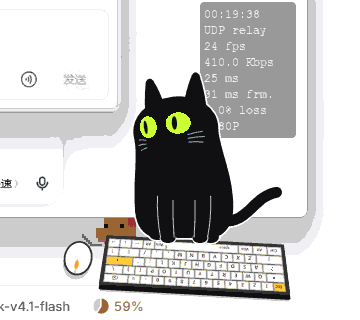

# 🐈‍⬛ KuroCat Own

> 一只自用的 Windows 桌面猫：**打字 / 鼠标操作实时反馈** + **数据驱动的皮肤系统**。
> 基于 [chanke17/KuroCat](https://github.com/chanke17/KuroCat) v1.4.0（MIT）移植改造，自带 7 款毛色，可导入自定义皮肤。

<p align="center">
  
</p>

<p align="center">
  
  
  
  
  
</p>

---

## ✨ 它能做什么

| | 能力 | 说明 |
|---|---|---|
| ⌨️ | **打字实时反馈** | 全局键盘监听（Raw Input 硬件扫描码），任意窗口 / 游戏都能看到猫爪敲键、键帽亮起 |
| 🖱️ | **鼠标跟手** | 左右中键分别响应；光标移动时猫头做 2.5D 转头、瞳孔跟随 |
| 🎨 | **数据驱动皮肤** | `.kurocat` 是 JSON 描述的毛色 / 花纹 / 体型数据，不是贴图；改 JSON 就换猫 |
| 👗 | **换装间** | 右键小猫 →「猫咪皮肤」切换；把 `.kurocat` 拖进换装间即可导入 |
| 🖥️ | **多显示器 / 缩放** | 记住位置，5 档缩放（50%–200%），支持置顶与完全鼠标穿透 |
| 🪟 | **透明置顶** | 逐像素透明分层窗口（`UpdateLayeredWindow`），不挡桌面操作 |
| ⚡ | **轻量** | 单文件 1.3 MB、常驻约 30 MB 内存、零运行时依赖（静态链接） |
| 🔒 | **隐私** | 只读物理键位与鼠标动作，**不记录任何输入字符**、不联网上传 |

## 🎨 内置与附带的皮肤

| 文件 | 名称 | 特点 |
|---|---|---|
| `black.kurocat` | 经典小黑猫 | 原版黑猫，荧光黄绿瞳 |
| `shorthair.kurocat` | 美短 | 银虎斑加白 + 平顶白额纹 |
| `orangeWhite.kurocat` | 橘白猫 | 橘头顶 + 白胸白手套 |
| `siamese.kurocat` | 挖煤暹罗猫 | 暖燕麦奶白 + 焦糖面罩 + 宝石蓝瞳 |
| `ragdoll.kurocat` 🆕 | 暖奶茶布偶猫 | 奶油底 + 深色重点色 + 蓝眼 |
| `calico.kurocat` 🆕 | 三花猫 | 白底 + 橘 / 黑斑块分区 |
| `cow.kurocat` 🆕 | 奶牛猫 | 黑白燕尾服 + 白手套 + 门脸白条 |

> 皮肤格式见 [`docs/skin-format.md`](docs/skin-format.md)：颜色、曲线分区、矢量花纹、体型参数、贴纸，全部是数据。

## 🚀 快速开始

**直接下载**：到 [Releases](https://github.com/123caiji/kurocat-own/releases/latest) 取 `kurocat-own.exe`，双击即用（会先结束旧实例）。

**自己编译**（Windows，需要 MinGW g++ 或 MSVC）：

```bat
git clone https://github.com/123caiji/kurocat-own.git
cd kurocat-own
build-own.cmd        :: 产出 dist\kurocat-own.exe + dist\skins\
run-own.cmd          :: 启动
```

## 🧭 和官方 KuroCat 并存

两者用不同的注册表 / 互斥量 / 数据目录，可以同时安装、互不干扰：

| 项 | 本工程 | 官方 KuroCat |
|---|---|---|
| 窗口标题 | `KuroCat Own` | `KuroCat` |
| 注册表 | `HKCU\Software\KuroCatOwn` | `HKCU\Software\KuroCat` |
| 单实例锁 | `Local\KuroCatOwn_SingleInstance` | `Local\KuroCatDesktopPetSingleInstance` |
| 数据目录 | `%APPDATA%\KuroCatOwn\` | `%APPDATA%\KuroCat\` |
| 皮肤目录 | `dist\skins\`（随包）+ 用户导入 | `%APPDATA%\KuroCat\skins\` |

## 📁 目录结构

```text
kurocat-own/
├─ windows/src/       Win32 应用壳 + 渲染器 + 输入引擎 + 皮肤库
├─ shared/            SkinSpec.hpp：.kurocat 解析（三端共用格式）
├─ skins/             皮肤源文件（.kurocat）
├─ dist/skins/        随包分发的皮肤（运行时从这里加载）
├─ docs/
│  ├─ skin-format.md  皮肤格式规范
│  ├─ ROADMAP.md      二次创作方向与优先级
│  └─ media/          演示 GIF / 截图
├─ tools/             截图与 GIF 生成工具（零依赖）
├─ build-own.cmd      一键编译
└─ run-own.cmd        一键启动
```

## 🗺️ 二次创作路线

想做自己的猫、自己的玩法？见 **[docs/ROADMAP.md](docs/ROADMAP.md)** —— 皮肤生态、行为创新、数据可视化、集成扩展、工程化五条线，附工作量与优先级。

## 📄 许可与来源

MIT。本工程是 **chanke17/KuroCat** 的自有分支，来源、改动与署名见 [NOTICE.md](NOTICE.md)；皮肤阵容参考 **qianyiai/kurocat**。
原始版权与许可全文见 [LICENSE](LICENSE)。
